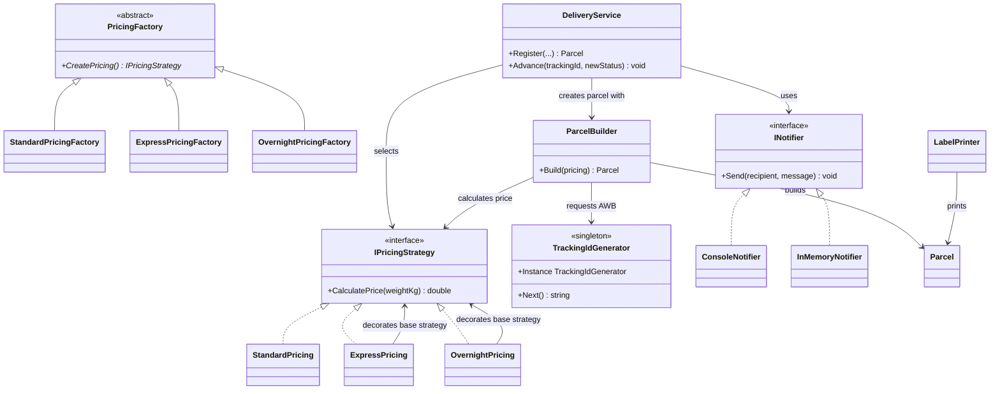
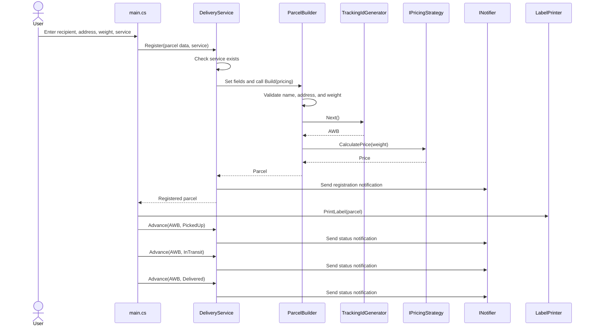
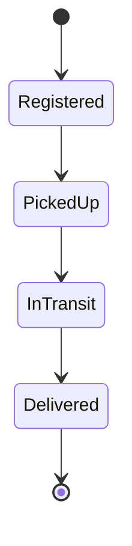

# Parcel Delivery System

## Laboratory Report: SOLID Principles and Design Patterns

**Project:** Parcel Delivery System  
**Language:** C#  
**Stuent:** Rotaru Anastasia, FAF-242  

## 1. Introduction

This project is a small parcel delivery application developed to demonstrate selected SOLID principles and object-oriented design patterns. It accepts parcel and recipient details, calculates the delivery price according to the selected service, generates a tracking number (AWB), prints a shipping label, and simulates the parcel's progress through its delivery statuses.

The project focuses on separating responsibilities and making parts of the application replaceable or extendable. Pricing rules, notifications, parcel construction, and tracking-number generation are handled by distinct components.

## 2. Objectives

- Apply the Single Responsibility, Open/Closed, and Dependency Inversion principles.
- Use Strategy to represent interchangeable pricing rules.
- Use Factory Method to create the appropriate pricing strategy.
- Use Builder to construct and validate a parcel.
- Use Singleton to provide one tracking ID generator.
- Demonstrate the interaction of these components in a working console application.

## 3. Application Overview

The application prompts the user for:

- recipient name and email address;
- street and city;
- parcel weight in kilograms;
- delivery service: `standard`, `express`, or `overnight`.

If the input passes validation, the application registers the parcel, prints its label, and advances it through the following statuses:

```text
Registered -> PickedUp -> InTransit -> Delivered
```

The application sends a notification when the parcel is registered and whenever its status changes.

## 4. Design Patterns

### 4.1 Strategy

The Strategy pattern encapsulates interchangeable algorithms behind a common interface. In this project, `IPricingStrategy` defines the `CalculatePrice` operation, while each pricing class implements a different rule:

- **Standard:** 5.00 lei base fee plus 1.50 lei per kilogram.
- **Express:** twice the standard price.
- **Overnight:** the standard price plus 15.00 lei.

`DeliveryService` uses the selected strategy without containing the individual pricing formulas. For a 2.5 kg parcel, the prices are 8.75 lei for standard, 17.50 lei for express, and 23.75 lei for overnight.

**Benefit:** a pricing rule can be added or changed independently of the parcel registration flow.

### 4.2 Factory Method

The Factory Method pattern delegates object creation to factory classes. The abstract `PricingFactory` declares `CreatePricing()`, and the concrete factories create the corresponding strategy:

- `StandardPricingFactory` creates `StandardPricing`.
- `ExpressPricingFactory` creates `ExpressPricing`.
- `OvernightPricingFactory` creates `OvernightPricing`.

In `main.cs`, a dictionary associates each service name with its factory. The factories are used to create the strategy dictionary passed to `DeliveryService`.

**Benefit:** the code that configures the application does not need to construct each pricing strategy directly in multiple places.

### 4.3 Builder

The Builder pattern constructs a more complex object step by step. `ParcelBuilder` provides a fluent sequence of methods:

```csharp
new ParcelBuilder()
    .To(name, email)
    .Destination(address)
    .Weight(weight)
    .Service(service)
    .Build(pricing);
```

`Build()` validates the required data before creating the `Parcel`. When validation succeeds, it obtains a tracking ID, calculates the price using the supplied pricing strategy, and creates the parcel.

**Benefit:** construction is readable, and validation is centralized rather than scattered across the application.

### 4.4 Singleton

The Singleton pattern provides a single shared instance of `TrackingIdGenerator`. Its constructor is private, and callers access the instance through `TrackingIdGenerator.Instance`.

- `Lazy<T>` creates the instance when it is first needed and is thread-safe by default.
- A `lock` protects the counter while `Next()` generates and increments the sequence.
- Tracking IDs have the form `RO000001`, `RO000002`, and so on.

**Benefit:** the application uses one generator and avoids duplicate IDs caused by concurrent calls within the same process.

**Limitation:** the counter exists only in memory. It starts again at `RO000001` after the application is restarted. A production system would need persistent storage, such as a database or a dedicated ID service.

## 5. SOLID Principles

### 5.1 Single Responsibility Principle (SRP)

The Single Responsibility Principle states that a class should have one primary responsibility:

- `Parcel` holds parcel data.
- `Address` represents a destination address.
- `LabelPrinter` formats and prints the shipping label.
- Pricing classes calculate prices.
- `DeliveryService` manages parcel registration, storage, status transitions, and notifications.

For example, changing the label layout belongs in `LabelPrinter` and should not require changing the pricing rules.

### 5.2 Open/Closed Principle (OCP)

The Open/Closed Principle states that software should be open to extension but closed to unnecessary modification. Pricing is represented by `IPricingStrategy`, so a new pricing implementation can be added without rewriting the existing pricing formulas or the core registration flow in `DeliveryService`.

In the current console setup, a new service must also be registered in the factory dictionary in `main.cs`. This is the application's composition point, where its available services are configured.

### 5.3 Dependency Inversion Principle (DIP)

The Dependency Inversion Principle encourages high-level components to depend on abstractions rather than concrete implementations. `DeliveryService` receives its notifier and pricing strategies from outside rather than constructing a specific notifier or hard-coding pricing classes.

The `INotifier` abstraction has two implementations:

- `ConsoleNotifier` prints notifications to the console.
- `InMemoryNotifier` stores notifications in memory, which can be useful in tests.

This makes it possible to replace the notification implementation without changing the delivery logic.

## 6. Input Validation and Business Rules

The application currently validates the following:

1. **Weight input format:** `main.cs` uses `double.TryParse`; input that cannot be parsed as a number is rejected.
2. **Service name:** `DeliveryService` rejects a service that is not present in the configured service dictionary.
3. **Recipient name:** `ParcelBuilder.Build()` rejects an empty or whitespace-only name.
4. **Destination object:** the builder requires an `Address` object.
5. **Weight range:** the builder accepts weights greater than 0 and up to and including 30 kg.

The 30 kg maximum is a business rule selected for this laboratory, not a universal courier-industry limit. The current implementation does not validate the email format or ensure that the street and city strings are non-empty.

## 7. Parcel Registration and Delivery Flow

1. `main.cs` creates the service factories and builds the pricing strategy dictionary.
2. It creates `DeliveryService` with an `INotifier` implementation and the available strategies.
3. The user enters parcel information.
4. `DeliveryService.Register()` confirms that the requested service exists.
5. `ParcelBuilder` validates the recipient name, address object, and weight.
6. After validation, the builder requests an AWB from `TrackingIdGenerator` and calculates the price through the selected strategy.
7. `DeliveryService` stores the parcel and sends a registration notification.
8. `LabelPrinter` prints the parcel label.
9. `DeliveryService.Advance()` moves the parcel one valid step at a time and sends a notification after each transition.

Invalid status transitions are rejected; for example, the parcel cannot move directly from `Registered` to `Delivered`.

## 8. Diagrams

### 8.1 Component and Pattern Relationships

This diagram shows how the application entry point configures the delivery service and how the main patterns collaborate.



### 8.2 Parcel Registration and Delivery Sequence

The sequence diagram follows one valid parcel registration, then shows the status updates.



If validation fails, `Build()` throws an `ArgumentException`; the AWB is requested only after the validation checks pass.

### 8.3 Parcel Status State Diagram

Only the next status in the delivery flow is allowed.



## 9. Source File Responsibilities

| File | Responsibility |
|---|---|
| `main.cs` | Configures the application, gathers input, registers the parcel, and runs the delivery demonstration. |
| `SRP.cs` | Defines `Parcel`, `Address`, `ParcelStatus`, and `LabelPrinter`. |
| `OCP.cs` | Defines `IPricingStrategy` and the standard, express, and overnight pricing implementations. |
| `DIP.cs` | Defines `INotifier`, its implementations, and `DeliveryService`. |
| `Factory.cs` | Defines `PricingFactory` and the concrete pricing factories. |
| `Builder.cs` | Defines `ParcelBuilder` and parcel input validation. |
| `Singleton.cs` | Defines the singleton `TrackingIdGenerator`. |
| `TMPS.csproj` | Configures the executable project and its .NET target framework. |

## 10. Build and Run

The .NET 10 SDK is required. From the project directory, run:

```bash
dotnet build
dotnet run
```

Alternatively, run the project from another directory by specifying its project file:

```bash
dotnet run --project TMPS.csproj
```

Example input:

```text
Recipient name: Ion Popescu
Recipient email: ion@example.com
Street: Str. Stefan cel Mare 1
City: Chisinau
Weight (kg): 2.5
Service (standard / express / overnight): express
```

The expected express price for a 2.5 kg parcel is 17.50 lei.

## 11. Conclusion

The project demonstrates how design patterns and SOLID principles can divide an application into focused components. Strategy isolates pricing algorithms, Factory Method creates the required strategy, Builder assembles and validates parcel data, and Singleton provides a shared tracking ID generator. SRP separates responsibilities, OCP supports extension of pricing behavior, and DIP allows dependencies such as notifications to be replaced.

The result is a small but cohesive example of how object-oriented design can improve readability, maintainability, and testability. For a production system, further work would include persistent tracking IDs and stronger validation for email and address fields.
